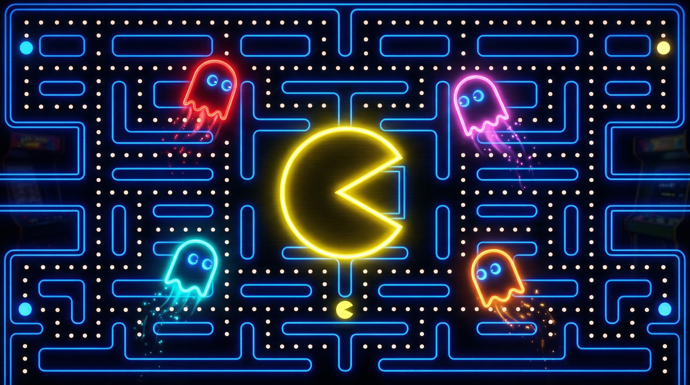

# 🟡 PAC-MAN Arcade Edition

A high-end, browser-based PAC-MAN clone with authentic original game mechanics, stunning neon visuals, procedural sound effects, multiple difficulty levels, and hidden easter eggs.



## 🎮 Spielen

Das Spiel einfach im Browser öffnen – keine Installation nötig:

```bash
# Lokal öffnen
open index.html

# Oder auf einem Webserver
# Siehe Deployment-Anleitung unten
```

**Live Demo:** Einfach `index.html` im Browser öffnen.

## ✨ Features

### Authentische Mechaniken
- **Original Pac-Man Labyrinth** (28×31 Tiles)
- **4 Geister mit einzigartiger KI**: Blinky (Jäger), Pinky (Hinterhalt), Inky (Unberechenbar), Clyde (Schüchtern)
- **Scatter/Chase-Zyklen** mit authentischem Timing
- **Frightened Mode** mit Ghost-Eating-Combos (200→400→800→1.600 Punkte)
- **Cruise Elroy** Modus (Blinky wird schneller bei wenigen verbleibenden Dots)
- **Input Buffering** (Richtungseingabe vor Kreuzung)
- **Bonus-Früchte** (Cherry→Strawberry→Orange→Apple→Melon→Galaxian→Bell→Key)

### 3 Schwierigkeitsgrade
| Feature | Easy | Normal | Hard |
|---------|------|--------|------|
| Geister-Geschwindigkeit | 60% | 88% | 108% |
| Pac-Man Geschwindigkeit | 112% | 100% | 100% |
| Power-Pellet Dauer | 2.5× | 1.4× | 0.7× |
| Leben | 5 | 4 | 3 |
| Extra-Leben bei | 5.000 | 7.500 | 10.000 |
| Geister-"Dummheit" | 20% | 8% | 0% |

### Visuelle Effekte
- Neon-Glow Labyrinth-Wände mit Bloom-Effekt
- CRT-Scanline & Vignetten-Overlay
- Partikel-Trail hinter Pac-Man
- Partikel-Burst beim Dot-Essen
- Screen-Shake beim Geister-Fressen
- Pulsierende Power Pellets
- Farbwechsel des Labyrinths alle 4 Level (Blau→Lila→Grün→Rot→Gold)
- Ambient-Partikel im Hintergrund
- Level-Übergangs-Animation

### Sound (Prozedural / Web Audio API)
- Waka-Waka Essgeräusch
- Power Pellet Sweep
- Geister-Eat Ascending Tone
- Tod-Animation mit chromatischem Abstieg
- Level-Complete Arpeggio
- Dynamische Sirene (Tonhöhe steigt mit weniger Dots)
- Frightened-Modus Ambient-Sound
- Frucht-Eat Chime
- Extra-Leben Fanfare
- Intro-Jingle

### Easter Eggs 🥚
- **Konami Code**: ↑↑↓↓←→←→BA auf dem Titelbildschirm
- **Fun Facts**: `?` drücken während Pause
- Mehr zu entdecken...

## 🎹 Steuerung

| Taste | Aktion |
|-------|--------|
| `←` `→` `↑` `↓` / `WASD` | Pac-Man bewegen |
| `Leertaste` | Spiel starten / Pause |
| `ESC` / `P` | Pause |
| `M` | Sound An/Aus |
| `T` | Speed-Timer An/Aus |
| `?` | Fun Fact (in Pause) |
| Touch/Swipe | Mobile Steuerung |

## 📁 Projektstruktur

```
PacMan-Web-Version/
├── index.html          # Komplettes Spiel (HTML + CSS + JS)
├── assets/
│   └── title-bg.png    # Titelbildschirm Hintergrundbild
├── README.md           # Diese Datei
├── TECHNICAL.md        # Technische Dokumentation
├── GAME_SPEC.md        # Original-Spielspezifikation
├── IMPROVEMENTS.md     # Changelog der Verbesserungen
├── deploy/
│   ├── apache.conf     # Apache Virtual Host Konfiguration
│   ├── .htaccess       # Apache .htaccess mit Caching & Security
│   └── deploy.sh       # Automatisches Deployment-Script
├── .gitignore          # Git Ignore Regeln
└── LICENSE             # MIT Lizenz
```

## 🚀 Deployment auf Ubuntu/Apache

### Schnell-Anleitung

```bash
# 1. Repository klonen
git clone git@github.com:oliverdevtron/PacMan-Web-Version.git

# 2. Deployment-Script ausführen
cd PacMan-Web-Version
chmod +x deploy/deploy.sh
sudo ./deploy/deploy.sh
```

### Manuelle Installation

```bash
# Apache installieren (falls nicht vorhanden)
sudo apt update && sudo apt install apache2 -y

# Dateien kopieren
sudo mkdir -p /var/www/pacman
sudo cp index.html /var/www/pacman/
sudo cp -r assets/ /var/www/pacman/
sudo cp deploy/.htaccess /var/www/pacman/

# Apache-Config kopieren & aktivieren
sudo cp deploy/apache.conf /etc/apache2/sites-available/pacman.conf
sudo a2ensite pacman
sudo a2enmod headers rewrite expires
sudo systemctl reload apache2
```

Detaillierte Anleitung: siehe [TECHNICAL.md](TECHNICAL.md)

## 🛠️ Technologie

- **HTML5 Canvas** (2D Context)
- **Vanilla JavaScript** (kein Framework)
- **Web Audio API** (prozeduraler Sound)
- **Google Fonts** (Press Start 2P, Inter)
- **Zero Dependencies** – keine npm Pakete, kein Build-Prozess

## 📊 Browser-Kompatibilität

| Browser | Unterstützung |
|---------|--------------|
| Chrome 90+ | ✅ Voll |
| Firefox 90+ | ✅ Voll |
| Safari 15+ | ✅ Voll |
| Edge 90+ | ✅ Voll |
| Mobile Chrome | ✅ Touch-Steuerung |
| Mobile Safari | ✅ Touch-Steuerung |

## 📝 Lizenz

MIT License – siehe [LICENSE](LICENSE)

## 🙏 Credits

- Originalspiel-Design: Toru Iwatani (Namco, 1980)
- Diese Implementierung: Erstellt mit [Perplexity Computer](https://www.perplexity.ai/computer)
